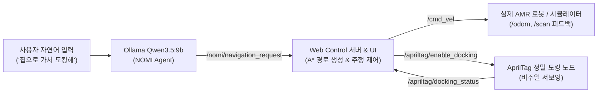

# NOMI — XLeRobot 통합 개발 저장소

ROS 2 Jazzy 기반 NOMI Agent, 자연어 LLM 인터페이스, Web Control 자율주행 및 정밀 도킹(AprilTag), MuJoCo/Gazebo 시뮬레이션 및 로봇암 통합 인터페이스를 함께 관리하는 협업 저장소입니다.

---

## 🚀 전체 시스템 실행 가이드 (LLM + Web App + Robot/Sim)

본 시스템은 **Ollama LLM (Qwen3.5 9B) $\to$ NOMI Agent $\to$ Web Control Bridge $\to$ 실제 AMR 로봇 / 시뮬레이션** 파이프라인으로 구성됩니다.  
모든 노드는 동일한 `ROS_DOMAIN_ID=30` 환경에서 실시간 통신합니다.



### 0. 사전 준비 (Prerequisites)

1. **ROS 2 및 가상환경**:
   - ROS 2 Jazzy (`/opt/ros/jazzy`)
   - Python 3.12 가상환경 (`~/venvs/xlerobot_mujoco`)
   - 작업 공간 빌드 완료 (`~/ros2_ws/install`)
2. **Ollama LLM 모델 확인**:
   ```bash
   ollama list
   # qwen3.5:9b 모델이 설치되어 있어야 합니다.
   # 미설치 시: ollama pull qwen3.5:9b
   ```

---

### 1. 단계별 실행 순서 (터미널 1 ~ 5)

각 단계를 별도의 터미널 탭에서 순서대로 실행합니다.

#### [터미널 1] Ollama LLM 서버 기동
```bash
ollama serve
```
> 기본 포트 `http://127.0.0.1:11434`에서 실행됩니다. (이미 시스템 서비스로 실행 중인 경우 생략 가능)

#### [터미널 2] NOMI Agent (자연어 LLM 에이전트)
```bash
source /opt/ros/jazzy/setup.bash
source ~/ros2_ws/install/setup.bash
source ~/venvs/xlerobot_mujoco/bin/activate
export ROS_DOMAIN_ID=30
export NOMI_MODEL_PROFILE=qwen35_single
export OLLAMA_HOST=http://127.0.0.1:11434

python3 ~/ros2_ws/install/nomi_agent/lib/nomi_agent/agent
```
> 기동 성공 시 다음 로그가 출력됩니다:
> - `[nomi_agent]: NOMI Agent: validated Function/Tool Harness 시작`
> - `[nomi_agent]: 활성 모델 프로필: qwen35_single`
> - `[nomi_agent]: 명령 토픽: /nomi/command · 상태 토픽: /nomi/task_status`

#### [터미널 3] Web Control 백엔드 서버 (FastAPI + Socket.IO + ROS 2 Bridge)
```bash
cd ~/dapier_project11/XLeRobot/web_control/server
source /opt/ros/jazzy/setup.bash
source ~/venvs/xlerobot_mujoco/bin/activate
export ROS_DOMAIN_ID=30

python3 main.py
```
> 백엔드가 `http://0.0.0.0:8000`에서 실행되며, NOMI ROS 2 그래프(`/nomi/*`, `/odom`, `/scan`, `/apriltag/*`)와 웹 클라이언트를 실시간 브리지합니다. 프로덕션 빌드된 클라이언트 UI도 이 포트로 함께 서비스됩니다.

#### [터미널 4 (선택)] 프런트엔드 실시간 개발 서버 (Vite)
웹 UI 소스 코드를 수정하며 HMR(Hot Module Replacement) 실시간 반영을 확인하려는 경우에만 실행합니다:
```bash
cd ~/dapier_project11/XLeRobot/web_control/client
pnpm run dev
# 브라우저 접속: http://localhost:5173
```

#### [터미널 5] 로봇 또는 시뮬레이션 환경 선택

사용하려는 테스트 환경에 맞춰 아래 옵션 중 하나를 실행합니다:

- **옵션 A: 실제 AMR 로봇 구동 시 (Physical Robot)**
  ```bash
  export ROS_DOMAIN_ID=30
  ros2 launch amr_bringup autonav.launch.py
  # 또는 정밀 도킹 노드 단독 실행:
  ros2 run amr_bringup apriltag_docking_node
  ```

- **옵션 B: AprilTag 인터랙티브 비전 & 도킹 시뮬레이터 (추천)**
  ```bash
  export ROS_DOMAIN_ID=30
  python3 ~/ros2_amr_ws/tools/sim_docking_interactive.py --port 8090
  # 브라우저 접속: http://localhost:8090
  ```

- **옵션 C: Gazebo 3D 물리 시뮬레이션**
  ```bash
  export ROS_DOMAIN_ID=30
  ros2 launch amr_bringup simulation_docking.launch.py
  ```

- **옵션 D: MuJoCo 시뮬레이터 (Manipulator + Base)**
  ```bash
  source /opt/ros/jazzy/setup.bash
  source ~/ros2_ws/install/setup.bash
  source ~/venvs/xlerobot_mujoco/bin/activate
  export ROS_DOMAIN_ID=30
  ros2 run nomi_xlerobot_sim mujoco_host
  ```

---

## 💬 자연어 명령 및 동작 시퀀스

1. 웹 브라우저에서 **`http://localhost:8000`** (개발 서버 사용 시 `http://localhost:5173`) 접속
2. 좌측 또는 하단 **NOMI 대화창**에 자연어 입력:
   - *"집으로 가줘"* 또는 *"홈 스테이션으로 이동해 줘"*
   - *"충전 위치로 가서 도킹해"*
   - *"테이블 1로 이동해"*
3. **전체 동작 흐름**:
   1. **LLM 추론**: Qwen3.5 모델이 발화를 파악하여 `navigate_to(location="홈 스테이션")` Tool Call 호출
   2. **A\* 자율주행**:
      - `[안전 언도킹]` 출발 전 후진으로 벽면/장애물 공간 확보
      - 2D 점유 지도 및 실시간 라이다 기반 장애물 회피 경로 추종
      - 목표 좌표 도달 후 목표 각도(Yaw) 정렬
   3. **AprilTag 정밀 도킹 (Visual Servoing)**:
      - 목표 지점이 도킹 대상(`tag_id` 지정 또는 홈/충전소)인 경우 `/apriltag/enable_docking (true)` 자동 발행
      - 전방 카메라를 통해 AprilTag 마커를 감지하고 3차 베지에 곡선으로 미세 정렬 및 초근접 밀착
      - 도킹 완료 시 실시간 HUD에 `🎉 도킹 완료 (완전 밀착 및 고정)` 표시

---

## 🛠️ 주요 환경 변수 요약

| 환경 변수 | 권장 설정값 | 설명 |
| :--- | :--- | :--- |
| `ROS_DOMAIN_ID` | `30` | 모든 터미널(실제 로봇, 도킹 노드, NOMI 에이전트, 웹 서버)에서 반드시 통일 |
| `NOMI_MODEL_PROFILE` | `qwen35_single` | 단일 Ollama Qwen3.5 9B 기반 라우팅 및 툴 호출 프로필 |
| `OLLAMA_HOST` | `http://127.0.0.1:11434` | Ollama API 서버 엔드포인트 |

---

## 📂 저장소 구조

- `XLeRobot/web_control/client`: React 19 + TypeScript + TailwindCSS 웹앱 (A* 경로 계획, AprilTag 도킹 HUD 모니터)
- `XLeRobot/web_control/server`: FastAPI + Socket.IO + ROS 2 Bridge (`nomi_bridge.py`)
- `XLeRobot/simulation/mujoco`: MuJoCo XML, STL 메시, 시뮬레이션 환경
- `ros2_ws/src/nomi_agent`: LLM Harness, Tool Registry, Safety Guard, Navigation Skill
- `ros2_amr_ws/src/amr_bringup`: AMR Bringup 런치 파일 및 AprilTag 정밀 도킹 노드 (`apriltag_docking_node.py`)
- `docs`: 설치 상세 가이드 (`SETUP_AND_RUN.md`), 테스트 결과, 기술 문서

---

## 🔧 문제 해결 (Troubleshooting)

- **로봇이 명령을 수신하지 못하거나 텔레메트리가 대기 상태인 경우**:
  - 모든 터미널의 `ROS_DOMAIN_ID`가 동일한지 확인하세요 (`echo $ROS_DOMAIN_ID`).
- **Ollama 연결 오류**:
  - `curl http://127.0.0.1:11434/api/tags`로 서비스 정상 동작 여부를 확인하세요.
- **노드 종료 시 `publisher's context is invalid` 오류**:
  - 최신 패치로 `ExternalShutdownException` 및 ROS Context 안전 가드가 적용되어 크래시 없이 정상 종료됩니다.
